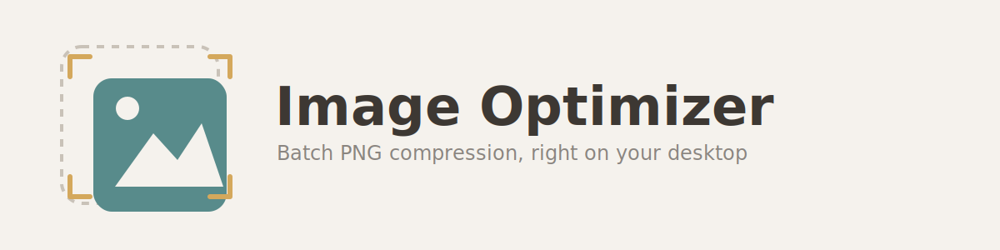

<picture>
  <source media="(prefers-color-scheme: dark)" srcset="assets/banner.png">
  
</picture>

# Image Optimizer

Batch image compression with a local web UI. Uses **pngquant** (lossy PNG
quantization) and **oxipng** (lossless strip/optimization) behind a clean
interface, plus **WebP via Pillow**, **AVIF via avifenc**, and — with
**mozjpeg's cjpeg** — true lossy **JPEG** re-compression that keeps the
JPEG format. Includes a dedicated **Screenshot mode** for near-lossless
compression of UI/software screenshots.

## Features

- **Local folder scanning** — select a directory, scan recursively (optional), and pick which files to optimize
- **File upload** — drag or browse to upload individual images (PNG, JPG, BMP, TIFF, WebP)
- **File sorting** — sort scanned files by modified/created time (newest/oldest) or size (large/small), handy for grabbing the latest screenshots or targeting the biggest files
- **Watch Mode** — monitor a folder and auto-optimize new or changed images as they appear, with live SSE-streamed logs and rename detection
- **Batch resume** — progress is persisted per output folder; an interrupted batch (crash, cancel, server restart) can be resumed where it left off
- **Pause / Resume / Cancel** mid-batch, plus per-file compression parameter overrides and single-file pre-compression preview
- **Before/after preview** — overlay and side-by-side compare views
- **Four compression modes:**
  - `standard` — pngquant + oxipng, best size reduction
  - `lossless` — oxipng only, no color loss
  - `resize only` — scale down, no quantization
  - `screenshot` — near-lossless pngquant pass tuned for UI/software screenshots (PNG-only, hardcoded dithering off)
- **Output format** — PNG (via pngquant/oxipng), WebP (via Pillow's built-in encoder, no extra binary needed), JPG (via mozjpeg's `cjpeg`, keeping JPEG rather than converting), or AVIF (via `avifenc`)
- **Keep-format JPEG optimization** — select the JPG output format on a batch of `.jpg` files and they're genuinely re-compressed lossily by mozjpeg while staying JPEG (requires `cjpeg` in `bin/`, see `bin/README.md`)
- **EXIF retention** (opt-in) — keep a curated EXIF subset (camera, date, exposure; GPS stripped for privacy)
- **Color protection** — list hex colors to preserve in the palette
- **Dithering toggle** — smoother gradients (standard mode)
- **Results sorting & filtering** — sort results by compression %, compressed size, or bytes saved; filter to show all/succeeded/failed
- **Dark mode** — manual theme toggle or auto-follow OS preference
- **Internationalization** — English and 中文 (Chinese) built-in, extensible to more languages
- **SSE progress transport** — real-time server-sent events for progress/logs with automatic polling fallback
- **Output directory** — save results to any folder (or use the built-in ZIP download), with a Reveal Output Folder button to jump straight to it in the OS file explorer
- **Skip already optimized** — re-running against the same output folder reuses existing outputs instead of recompressing unchanged files (settings-aware: changing quality/mode/format forces a real recompress)
- **Recent folder history** — quick-access chips with per-item removal and clear all
- **In-app settings** — gear icon opens a settings panel (host, port, workers, timeouts, language) persisted to `config.json`
- **Session state restoration** — page refresh restores files/results and re-attaches to a still-running batch
- **Auto-detect binaries** — finds `pngquant`/`oxipng`/`cjpeg`/`avifenc` on PATH, in `bin/`, or in the per-user cache filled by the first-run download
- **CLI mode** — `--source`/`--output` runs a batch headlessly (no browser, no server) and exits with a process exit code, for scripts and CI; shares the exact same compression pipeline and settings validation as the web UI
- **Cross-platform** — Windows, macOS, Linux (pre-built downloads for Windows, Apple Silicon Macs and Linux x86-64; the pip package fetches verified upstream binaries on first run where the publisher ships one, otherwise the tools come from PATH)

## Quick Start

### Option 1: pip (any OS)

```bash
pip install image-optimizer-webui
image-optimizer serve
```

Open http://127.0.0.1:8090. Bare `image-optimizer` does the same thing — `serve`
is accepted as a synonym because that is the convention elsewhere.

The first start downloads the encoder binaries this platform can get from
upstream (see [Encoder binaries](#encoder-binaries)), verifies each against a
pinned SHA-256, and caches it in your user data directory. The wheel itself is
pure Python and ships no third-party executables.

### Option 2: Standalone download (no Python required)

Download the latest release from the [Releases page](https://github.com/aREversez/image-optimizer/releases):

- **Windows:** run `ImageOptimizer-windows-x64.exe`
- **macOS (Apple Silicon):** open `ImageOptimizer-macos-arm64.dmg` and follow the `README.txt` inside
- **Linux (x86-64):** `tar -xzf ImageOptimizer-linux-x64.tar.gz && ./ImageOptimizer`

The macOS and Linux builds run in a terminal; open <http://127.0.0.1:8090> in your browser once they start.

> **Windows SmartScreen:** The exe is unsigned (code signing certificates cost $200+/year for open-source projects). On first run, SmartScreen may show "Windows protected your PC" — click **More info** → **Run anyway**. This is normal for unsigned open-source software. The macOS build is unsigned too (see the `README.txt` in the disk image).

### Option 3: From source

```bash
git clone https://github.com/aREversez/image-optimizer.git
cd image-optimizer
pip install -r requirements.txt
python -m image_optimizer   # or: image-optimizer, or start.bat
```

Open http://127.0.0.1:8090 in your browser.

The first run will auto-detect `pngquant`/`oxipng`/`cjpeg`/`avifenc` on PATH and
in the `bin/` folder, and fetch the pinned releases that are missing. See
`bin/README.md` if a binary is unavailable.

## Usage

1. **Enter a folder path** — type or browse to select a directory, then click *Scan Folder* (or drag & drop / upload individual files)
2. **Review files** — deselect any you want to skip, sort by date/size, adjust quality/width/mode (per-file overrides via each card's gear icon, or click *Preview* for a single-file dry run)
3. **Protect colors** (optional) — add hex colors like `#2ecc71` to preserve
4. **Start** — click *Start* and watch the live progress log (SSE-streamed)
5. **Compare & download** — click any result's *Compare* button for before/after preview, then download the ZIP or click *Reveal Output Folder* (when an output folder is set). Sort/filter results by compression ratio or size.

Alternatively, set up **Watch Mode** (sidebar card) to auto-compress new images dropped into a folder, and use *Resume* on page load if a previous batch was interrupted.

## CLI Mode

For scripting, batch jobs, or anything that shouldn't need a browser: pass
`--source` and the app runs headlessly (no web server, no browser) and
exits with a process exit code (`0` if everything succeeded, `1` if
anything failed — safe to check in a script or CI step).

```
image-optimizer --source "D:\screenshots" --output "D:\screenshots-compressed"
```

```
image-optimizer --source ./raw --output ./compressed --quality high --max-width 1920 --mode standard --no-dithering
```

(From a source checkout, `python -m image_optimizer` works identically.)

CLI mode runs every image through the exact same compression pipeline and
settings validation as the web UI and Watch Mode — no separate "CLI
version" of the logic to drift out of sync, so the same `--quality`/
`--mode`/etc. combination produces the same result either way.

- `--source` - directory to compress (required to trigger CLI mode)
- `--output` - output directory (required with `--source`)
- `--quality {high,medium,low}` - Standard/Screenshot mode color-quality floor (default `medium`)
- `--format {png,jpg,webp,avif}` - output format (default `png`)
- `--mode {standard,lossless,resize_only,screenshot}` - compression mode (default `standard`; `screenshot` is PNG-only)
- `--max-width <int>` - resize so the longest side is at most this many pixels (default `0` = no resize; required `> 0` with `--mode resize_only`)
- `--dithering` / `--no-dithering` - dithering for Standard-mode PNG quantization (default enabled)
- `--protect-colors "#2ecc71,#ff0000"` - hex colors to prioritize keeping exact in Standard mode's palette
- `--keep-exif` - keep a curated subset of EXIF (camera make/model, date, exposure); GPS and orientation are always stripped regardless (default: strip all EXIF)
- `--recursive` / `--no-recursive` - scan subfolders too (default `--recursive`; shared with `--dir`, see Configuration below)
- `--workers` - concurrent compression workers (shared with the web server's `--workers`, see Configuration below)
- `--cache-dir PATH` - enable the content-hash result cache (see below); default: no cache
- `--cache-max-size-mb N` - cache size cap, enforced after each run by evicting least-recently-used entries (default `1024`, `0` = unlimited)
- `--exclude GLOB` / `--include GLOB` - filter which files are processed; repeatable (see below)
- `--json` - print the final report as one JSON object on stdout (see below)

Output mirrors the source folder's directory structure. Name collisions
after a format conversion (e.g. `photo.png` and `photo.jpg` both becoming
`photo.png`) get a numbered suffix (`photo_2.png`) rather than silently
overwriting one another.

Not yet supported in CLI mode: per-file overrides (every file in the batch
gets the same settings). Without `--cache-dir`, every CLI run recompresses
everything under `--source`.

### Result cache

`--cache-dir` keeps finished results in a content-addressed cache, so an
unchanged image with the same settings is copied from the cache instead of
being recompressed. It does not depend on `--output`: a caller that uses a
fresh temporary output directory on every run still gets hits.

```
image-optimizer --source ./raw --output "$(mktemp -d)" --cache-dir ~/.cache/image-optimizer-cli
```

- The key covers the input file's bytes, the pixel-affecting settings (`--quality`, `--mode`, `--max-width`, `--protect-colors`, `--dithering`/`--no-dithering`, `--keep-exif`, `--format`) and the encoders in use (the content of the pngquant/oxipng/cjpeg/avifenc binaries, plus the Pillow version). Changing `--workers`, `--recursive`, `--include` or `--exclude` does not invalidate anything, and renaming or moving a file still hits.
- Only successful results are stored, never failures. A corrupt or truncated entry is treated as a miss and overwritten.
- The cache directory must not be inside `--source` or `--output` (equal to either is rejected too; a cache dir that merely *contains* `--output` is allowed). Only files matching the cache's own naming scheme (`<64 hex>.<format>` inside a two-hex-digit subfolder) are counted or evicted, so pointing `--cache-dir` at a directory that already holds other files leaves them alone.
- After each run the cache is trimmed to `--cache-max-size-mb` (default 1024 MB, `0` = unlimited) by deleting the least recently used entries first. Entries whose source image no longer exists are never hit again, so they age out on their own.
- The compression pipeline is covered by byte-determinism tests (`tests/test_determinism.py`); the cache is only valid because the same input and settings always produce the same bytes.
- AVIF cache hits need a Pillow build that can read AVIF (Pillow >= 11.3 with libavif; the official wheels bundle it and both `pyproject.toml` and `requirements.txt` pin that floor). Without AVIF read support the run warns on stderr and AVIF entries are never served.
- Entries written during a run are protected from that same run's eviction, so a run never deletes the results it just wrote (the cache may transiently sit above the cap; on the next run they are ordinary LRU candidates and, being the newest, are evicted last). A single entry larger than `--cache-max-size-mb` can never fit under the cap and is evicted once it is no longer protected; the run warns on stderr whenever it cannot get the cache back under the cap.
- Stale temporary files from crashed writers are swept at the end of every run, independent of the size cap.

### Filtering with --exclude / --include

```
image-optimizer --source ./raw --output ./out --exclude "*.bak" --exclude "drafts/*"
image-optimizer --source ./raw --output ./out --include "icons/*" --exclude "*_old.png"
```

- A pattern without `/` is matched against the file name at any depth (`*.bak` also hits `sub/dir/a.bak`). A pattern with `/` is matched against the path relative to `--source`, written with forward slashes (`drafts/*`, `icons/*.png`).
- Matching is case-insensitive on every platform, and `*` also matches `/` (`drafts/*` covers `drafts/old/a.png`).
- With `--include`, a file must match at least one include pattern. `--exclude` is applied afterwards and always wins when both match.
- Patterns match paths relative to `--source`: to filter a whole directory use `drafts/*` (a bare `drafts/` matches nothing), and `./`-prefixed or absolute patterns never match.
- Excluded files are not compressed, produce no output and never count as failures.

### Machine-readable report (--json)

With `--json`, the final report is a single JSON object on stdout and all human-readable output (progress lines, summary, warnings) goes to stderr, so stdout can be piped straight into a parser:

```
image-optimizer --source ./raw --output ./out --json | jq .summary
```

```json
{
  "files": [
    {"rel": "icons/a.png", "output_name": "a.png", "original_size": 20480,
     "compressed_size": 5120, "status": "compressed", "error": null}
  ],
  "summary": {"total": 1, "compressed": 1, "cached": 0, "excluded": 0, "failed": 0,
              "kept_original": 0, "original_size": 20480, "compressed_size": 5120,
              "saved_percent": 75.0}
}
```

`status` is one of `compressed`, `cached` (served from `--cache-dir`), `kept_original` (the result was not smaller, so the original's pixels were kept with metadata stripped), `excluded` or `failed`. Size totals and `saved_percent` cover the successful statuses; `total` counts every scanned file, excluded ones included. The exit code is unchanged: `1` only if a file failed. Setup errors (bad arguments, missing `--source`, an `--output` directory that cannot be created) exit `1` with a message on stderr and no JSON.

## Configuration

Command-line flags:

```
image-optimizer --host 127.0.0.1 --port 8090 --workers 4 --dir "D:\screenshots"
```

- `--host` — listen address (default `127.0.0.1`, see Security below)
- `--port` — listen port (default `8090`; if taken, the next free port is used automatically)
- `--workers` — how many images to compress concurrently (default `4`).
  Lower this if pngquant/oxipng are already maxing out your CPU; raise it on a
  many-core machine for faster batches.
- `--thumbnail-workers` — how many images to thumbnail concurrently during a
  scan (default `4`). Independent from `--workers`, so a scan's I/O-bound
  thumbnailing can be tuned separately from CPU-bound compression.
- `--dir` — auto-scan this folder on startup (opens the web UI with results pre-loaded)
- `--recursive` / `--no-recursive` — when used with `--dir` or `--source`,
  whether to scan subfolders too (default `--recursive`, the historical
  behavior). Pass `--no-recursive` to scan only the top level.

For settings you don't want to type every time, either use the **in-app
settings panel** (gear icon in the header — changes persist to
`config.json`; host/port/workers changes require a restart) or create a
`config.json` by hand in `~/.image-optimizer/` (that's
`%USERPROFILE%\.image-optimizer\config.json` on Windows, or
`~/.image-optimizer/config.json` on macOS/Linux — the same folder on every
OS, and the same one `recent.json` already lives in). Copy
[`config.example.json`](config.example.json) there and edit it, or start
from scratch with:

```json
{
  "host": "127.0.0.1",
  "port": 8090,
  "concurrent_workers": 4,
  "thumbnail_workers": 4,
  "workspace_cleanup_delay": 10.0,
  "session_idle_timeout_hours": 4
}
```

Other flags:

- `workspace_cleanup_delay` — seconds to wait before deleting a workspace after
  it's replaced by a new scan/upload (default `10.0`). Files aren't deleted
  immediately so an in-flight request — e.g. a ZIP download or an image still
  loading in another tab — has time to finish before they disappear out from
  under it. Raise this if you routinely have slow downloads running when you
  start a new scan; lower it to free disk space sooner.
- `session_idle_timeout_hours` — how long a browser session (and its scan
  results, in-progress state, and temp workspace) is kept after you stop
  using it before being cleaned up automatically (default `4`). Each browser
  tab/session is tracked separately so multiple tabs don't interfere with
  each other; this controls how long an abandoned one hangs around before
  its temp files are freed. Also sets how long the session cookie itself is
  valid for.

All keys are optional — only include the ones you want to change from the
default (an empty `{}` or a missing file both just mean "use every
default"). Command-line flags always override `config.json`, which
overrides the built-in defaults. Invalid values (e.g. a negative worker
count) are ignored with a startup warning rather than crashing.

## Security

This app has no authentication and is meant to run on `127.0.0.1` only (the
default). It can read any directory you point it at and write to any path
you specify as the output folder — fine for local, single-user use, but
**don't** start it with `--host 0.0.0.0` or a LAN address unless you fully
trust everyone on that network, since there's nothing stopping them from
reading or writing files on your machine through it.

To stop a malicious web page from reaching the local server through DNS
rebinding, the server refuses requests whose `Host` header is not a loopback
name (`localhost`), an IP address, or the host you started it with, and it
refuses state-changing requests that the browser marks as cross-site. If you
deliberately reach the app under another DNS name (a LAN hostname, a reverse
proxy), list it in the `IMAGE_OPTIMIZER_ALLOWED_HOSTS` environment variable
(comma separated, e.g. `mybox.lan,tools.example.com`). A proxy must also pass
the original `Host` header through, or the same-origin check will reject the
page's own requests.

## Requirements

- **pip install:** Python 3.10+ (dependencies are pulled in automatically)
- **Source install:** `pip install -r requirements.txt`, or `pip install -r requirements.lock`
  for the exact versions this was tested against
- **PNG compression:** `pngquant` and `oxipng` (PNG-only modes; JPG/WebP output and lossless
  fallbacks don't need them)
- **JPG output:** `cjpeg` from mozjpeg (keeps JPEG format instead of converting; see `bin/README.md`)
- **AVIF output:** `avifenc` from libavif (optional — without it the AVIF format simply isn't offered; see `bin/README.md`)
- **Standalone download:** Windows 10/11 64-bit, macOS on Apple Silicon, or Linux x86-64 (built on Ubuntu 24.04, so it needs a similarly recent glibc); no Python required (all four encoders bundled)

## Encoder binaries

The wheel is pure Python: `pngquant` is GPL-3.0-or-later, and every encoder is a
platform-specific blob, so none of them are redistributed here. On startup the
app looks for each one on PATH, then in the per-user directory below; whatever
is still missing gets downloaded from the publisher, verified against a pinned
SHA-256, and installed there.

The digest is the trust anchor: a download that does not match is discarded,
never executed.

| OS | Install location |
|---|---|
| Windows | `%LOCALAPPDATA%\ImageOptimizer\bin` |
| macOS | `~/Library/Application Support/ImageOptimizer/bin` |
| Linux | `$XDG_DATA_HOME/image-optimizer/bin` (default `~/.local/share/image-optimizer/bin`) |

Fetched automatically:

- **Windows x64** — all four: pngquant 2.17.0, oxipng 10.1.1, mozjpeg 4.0.3, libavif 1.4.2
- **macOS / Linux** — oxipng only; the others have no official standalone binary, so they
  come from your package manager (`brew install pngquant oxipng mozjpeg libavif`,
  `apt install pngquant oxipng mozjpeg libavif-bin`)

Offline, behind a proxy, or on an air-gapped network:

- `image-optimizer --no-download`, or set `IMAGE_OPTIMIZER_NO_DOWNLOAD=1`
- the app still starts — WebP output needs no external binary at all, and the UI only
  offers formats it can actually produce right now
- install manually into the directory above (PATH is searched first), and use
  `--force-download` later to replace a pinned copy
- startup prints the exact URL, target path and expected SHA-256 for anything it
  could not fetch

## Project Structure

```
image-optimizer/
├── image_optimizer/  # Python web application (import package)
│   ├── main.py       # FastAPI server & routes
│   ├── optimizer.py  # pngquant/oxipng/cjpeg/avifenc orchestration
│   ├── binaries.py   # first-run download + SHA-256 verification
│   ├── watcher.py    # Watch Mode directory poller
│   ├── models.py     # Pydantic request models
│   └── templates/    # HTML/CSS/JS frontend (single-page app with i18n)
├── assets/           # Logo, icons, banner images
├── bin/              # Local binary drop-in folder (dev/source runs)
├── tests/            # pytest test suite
├── build_exe.py      # PyInstaller build script (onefile mode)
├── pyproject.toml    # pip-installable package config
├── requirements.txt
└── start.bat
```

## License

MIT for this project's own code.

The pip package redistributes no third-party binaries. The executables it
downloads are unmodified upstream releases and stay under their own licenses —
pngquant (GPL-3.0-or-later), oxipng (MIT), mozjpeg's cjpeg (IJG + BSD-3-Clause),
libavif's avifenc (BSD-2-Clause) — each fetched from its own publisher, with
source links in `bin/README.md`. The Windows standalone exe bundles them, so
redistributing that exe carries their notice requirements.
